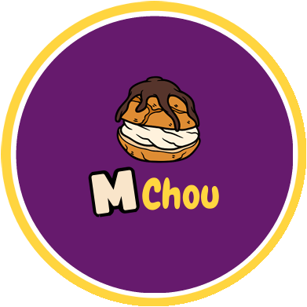
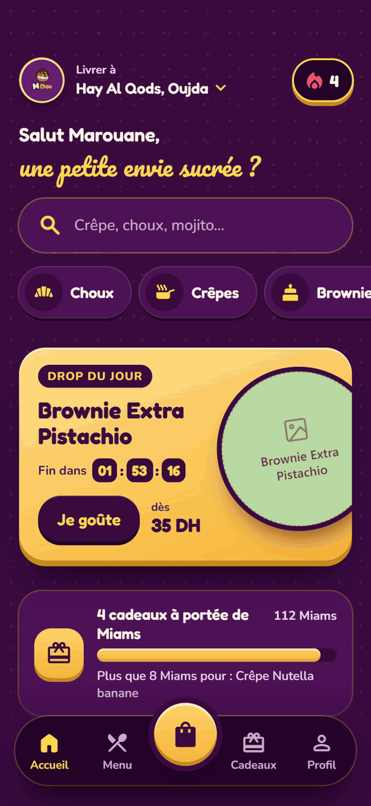
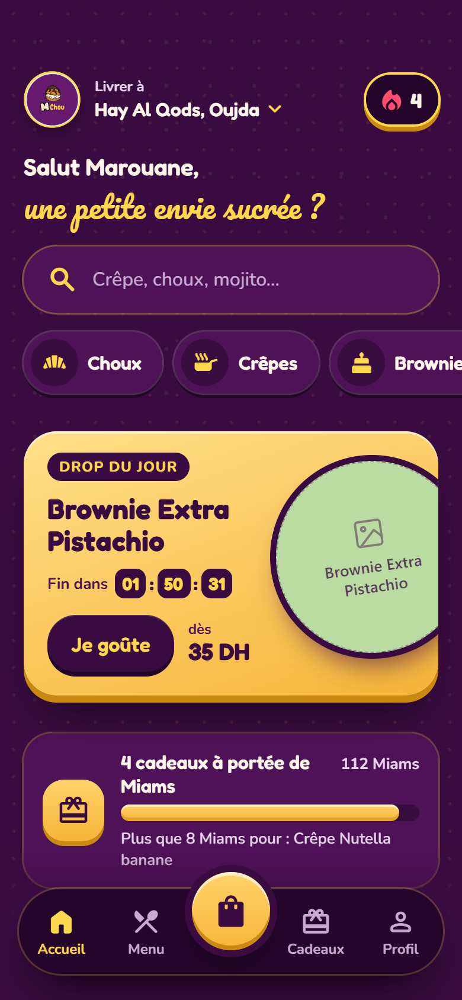
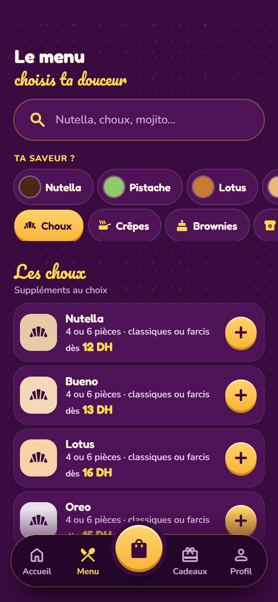
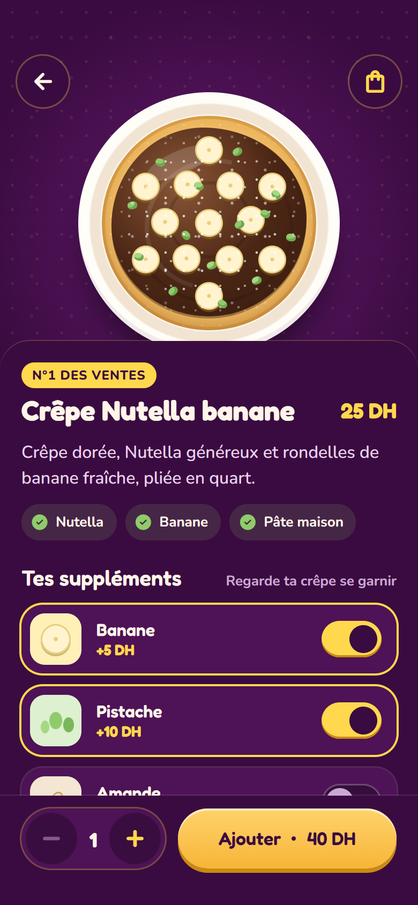
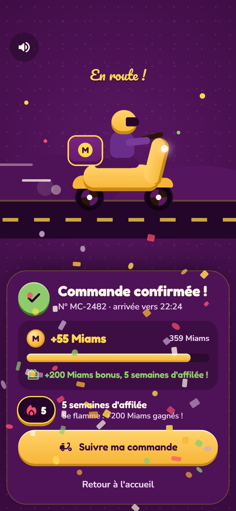
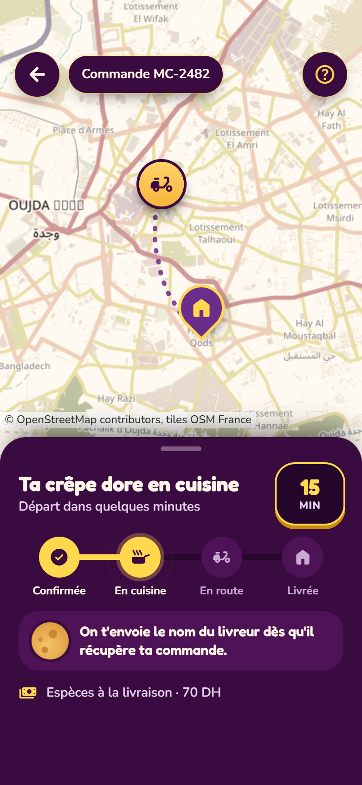
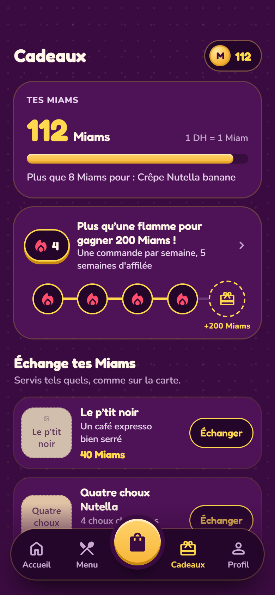
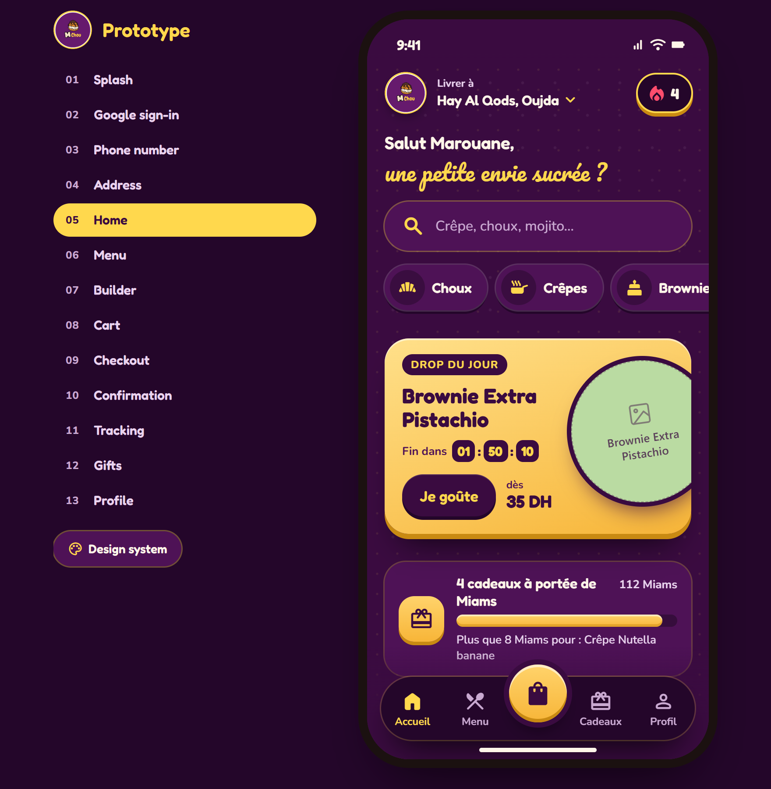

<div align="center">

🌐 [Français](README.md) · **English**



# M'Chou — the sweet-tooth app, prototyped

**Crêpes, choux, brownies, waffles, milkshakes and mojitos, ordered in three taps in Oujda.**

<a href="https://hicham-o-sfh.github.io/MChou-App/" target="_blank" rel="noopener"><b>▶ Try the prototype</b></a> ·
<a href="https://hicham-o-sfh.github.io/MChou-App/design-system.html" target="_blank" rel="noopener"><b>🎨 See the design system</b></a>



</div>

---

## 💡 The concept

M'Chou is a dessert spot in Oujda (Morocco): crêpes, sweet spaghetti, waffles, brownies, choux,
milkshakes, mojitos… a paper menu of **~115 items across 13 families**. The owner wanted to move
to app-based ordering and delivery **without losing the shop's vibe**: generous, colourful, a
bit playful.

This repo is the **interactive prototype** of that app. Not a static mockup: a real mini-app you
hold in your hand and can install on your phone, with its animations, sounds and little moments
of joy. It's the visual and behavioural reference for the final app, which will be built in
**Flutter**.

What you can do in it:

- 🍫 **Browse the entire real menu** by family *or* by flavour ("Your flavour? Pistachio" →
  pistachio crêpes, waffles, choux, brownies…).
- 🥞 **Build your own crêpe** in a visual builder: the base, toppings and extras land on the
  plate, and the price updates live.
- 🛒 **Order**: cart, address on a map, delivery slot, payment, confirmation.
- 🛵 **Track the delivery** in real time, from the kitchen to the door.
- 🎁 **Earn Miams** (1 DH = 1 Miam) and trade them for treats, with a streak flame that rewards
  regular orders.

<p align="center">
  
  
  
</p>

<p align="center">
  
  
  
</p>

## 🤝 The client's verdict

The prototype was presented to the client, Marouane, who **approved** it and was genuinely **surprised by
the result**: expecting screen images, he ended up building his own crêpe on a phone, watching
the scooter move across the map and confetti fall as his order arrived. The kind of demo where
you don't need to explain anything, you just hand over the phone.

---

## ✏️ The method: from paper to a living prototype

The real story of this project is **how it was made**. In a few days, it went from a chat around
a table to an app you can install. Here's the path.

### 💬 1. Understanding the need, with the client

It all starts with a **brainstorming session with the client**: what he sells, how his customers
order today, what's painful, what makes M'Chou different. We went through his **actual paper
menu** item by item, talked through the journeys ("I want a Nutella-banana crêpe delivered at
9 pm"), loyalty, and the tone of voice. Goal: start from his real need, not from a generic
delivery-app template.

### 📝 2. Sketching on paper

Then, **pen and paper**. Every screen is first drawn by hand: layout, hierarchy, gestures. It's
fast, you throw it away without regret, and it's where I think best.

Why not Figma? Honestly: I don't really master it, and for this phase I find it more heavy than
helpful. Paper lets me move at the speed of my ideas.

### 🎨 3. Bringing the sketches to life with Claude Design

The sketches then go to **<a href="https://claude.ai" target="_blank" rel="noopener">Claude Design</a>**, with **carefully crafted prompts**:
each screen's intent, visual identity, constraints (touch targets, a single primary button per
screen, tone of the copy…). Claude Design turns those drawings into real, consistent designed
screens, with a full **design system** (colours, type, radii, motion).

This is the step that turns "my ideas on paper" into something that **already looks like the
final app**.

### 🤖 4. Taking back control of the code with Claude Code

The Claude Design export (a `.zip` of `.dc.html` files) works, but the code is **messy and
ultra-compact**: inline styles everywhere, everything on a few lines, nearly impossible to read
or edit by hand.

With **Claude Code**, that export was **ported into a clean HTML / CSS / JS project**: one module
per screen, reusable components, a token file for the theme, tested business logic. Doing it by
hand would have been possible… but way too slow. Here, the AI handles the mechanical work while
I keep control of the architecture, the decisions and the review.

### 🔁 5. Iterating, fast

Once the code is clean, every tweak takes minutes: adjust a screen, check it in the browser,
show it, repeat. Each screen's specs and decisions are written down along the way, which will
feed straight into the Flutter development.

### ✨ Why it works

| Step | Tool | What it brings |
|---|---|---|
| Need | Talking with the client | An app designed for *his* business |
| Ideas | Pen and paper | Speed, freedom, zero friction |
| Design | Claude Design | Polished screens and a consistent design system |
| Code | Claude Code | A readable, maintainable prototype, ready to evolve |
| Demo | The browser / the phone | An *app-like* experience, not a picture |

The result: a prototype that **speaks far louder than a Figma mockup**, showing interactivity
and animations for real, delivered in record time. And for me, a project where I **learned a
ton**: about working with a client, about design systems, and about making AI a real teammate
at every step.

---

## 🛠️ Under the hood

### ⚡ In short

- **HTML / CSS / JavaScript**, native ES modules, **no build step**: open it and it runs.
- **<a href="https://lit.dev/docs/libraries/standalone-templates/" target="_blank" rel="noopener">lit-html</a>** for rendering: plain templates, and only
  the parts that change get updated in the DOM. So animations are never interrupted by a
  re-render, without shipping a whole framework.
- **A single state** shared by every screen, app-style navigation (screen stack, bottom sheets,
  toasts, transitions).
- **Leaflet + OpenStreetMap** for the address map and delivery tracking.
- **Design system as CSS variables** (`css/tokens.css`), showcased in
  <a href="https://hicham-o-sfh.github.io/MChou-App/design-system.html" target="_blank" rel="noopener">`design-system.html`</a>: the same
  source will feed Flutter's `ThemeData`.
- **Tested business logic** (pricing, cart, loyalty, time slots, phone numbers…) with
  `node --test`, zero dependencies.

Why this rather than a framework, or Flutter right away? Because the goal here is to **iterate
fast on design and behaviour**: no compilation, instant preview, code that both the AI and I can
read easily. Flutter comes once the prototype is locked in.

### 📱 On the web *and* on your phone

- **On desktop**: the prototype shows inside a phone frame, with a side panel to jump straight
  to any screen (handy for demos).
- **On a phone**: it goes full screen, like a real app.
- **Installable (PWA)**: open the <a href="https://hicham-o-sfh.github.io/MChou-App/" target="_blank" rel="noopener">prototype</a> in
  Chrome, menu ⋮ → **"Install app"**. It lands on your home screen with its icon and opens full
  screen.

<p align="center">
  
</p>

<!-- 📸 PLACEHOLDER — screenshot of the installed M'Chou icon on a phone home screen.
<p align="center">
  
</p>
-->

### 🚀 Run it locally

Any static HTTP server will do (ES modules don't load over `file://`), for example **Live
Server** in VS Code on `index.html`. An internet connection is needed, of course (lit-html,
fonts, icons and maps come from CDNs).

```bash
npm test
```

### 🗂️ Structure

```
index.html            the prototype
design-system.html    the design system showcase
css/                  theme tokens, components, one file per screen
js/screens/           one module per screen
js/components/        reusable UI pieces
js/logic/             pure, tested logic
js/data/              the real M'Chou menu, the gifts
tests/                logic tests
```

---

## 🔒 License

© 2026 Hicham Oussama Saffih, all rights reserved. Free to view, any reuse is prohibited without
written permission: see [LICENSE](LICENSE). The M'Chou name and logo belong to their owner.

---

<div align="center">

Designed and built by **Hicham Oussama Saffih**.

</div>
