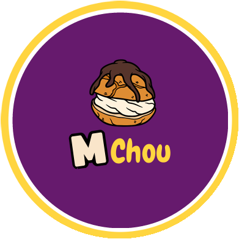

<div align="center">



# M'Chou — l'app gourmande, en prototype

**Crêpes, choux, brownies, gaufres, milkshakes et mojitos, commandés en trois taps à Oujda.**

<a href="https://hicham-o-sfh.github.io/MChou-App/" target="_blank" rel="noopener"><b>▶ Essayer le prototype</b></a> ·
<a href="https://hicham-o-sfh.github.io/MChou-App/design-system.html" target="_blank" rel="noopener"><b>🎨 Voir le design system</b></a>

<!-- 📸 PLACEHOLDER — GIF « hero » : un parcours complet (accueil → builder → panier → suivi), ~6-10 s.

-->

</div>

---

## 💡 Le concept

M'Chou, c'est une adresse gourmande d'Oujda (Maroc) : crêpes, spaghetti sucrés, gaufres,
brownies, choux, milkshakes, mojitos… une carte papier de **~115 produits sur 13 familles**.
Le client voulait passer à la commande et à la livraison par app, **sans perdre l'esprit de la
boutique** : généreux, coloré, un peu fun.

Ce dépôt, c'est le **prototype interactif** de cette app. Pas une maquette figée : une vraie
mini-app qu'on tient en main, qu'on peut installer sur son téléphone, avec ses animations, ses
sons et ses petits moments de plaisir. Elle sert de référence visuelle et comportementale pour
l'app finale, qui sera développée en **Flutter**.

Ce qu'on peut y faire :

- 🍫 **Parcourir toute la vraie carte** par famille *ou* par saveur (« Ta saveur ? Pistache » →
  crêpes, gaufres, choux, brownies… à la pistache).
- 🥞 **Composer sa crêpe** dans un builder visuel : la base, les garnitures et les extras se
  posent dans l'assiette, le prix suit en direct.
- 🛒 **Commander** : panier, adresse sur une carte, créneau de livraison, paiement, confirmation.
- 🛵 **Suivre la livraison** en temps réel, de la cuisine jusqu'à la porte.
- 🎁 **Gagner des Miams** (1 DH = 1 Miam) et les échanger contre des cadeaux, avec une flamme
  qui récompense les commandes régulières.

<!-- 📸 PLACEHOLDER — Galerie de captures d'écran (une ligne de 3 ou 4).
<p align="center">
  
  
  
  
</p>
-->

## 🤝 Le verdict du client

Le prototype a été présenté au client, qui l'a **validé** et a franchement été **surpris du
résultat** : il s'attendait à des images d'écrans, il s'est retrouvé à composer sa propre crêpe
sur un téléphone, à voir le scooter avancer sur la carte et les confettis tomber à
l'arrivée de sa commande. Le genre de démo où on n'a plus besoin d'expliquer, on tend juste le
téléphone.

---

## ✏️ La méthode : du papier au prototype qui vit

Le vrai sujet de ce projet, c'est **la façon dont il a été fait**. En quelques jours, on passe
d'une discussion autour d'une table à une app qu'on peut installer. Voici le chemin.

<!-- 📸 PLACEHOLDER — Image « avant / après » : un sketch papier à côté de l'écran final.
<p align="center">
  
  &nbsp;→&nbsp;
  
</p>
-->

### 💬 1. Comprendre le besoin, avec le client

Tout part d'un **brainstorming avec le client** : ce qu'il vend, comment ses clients commandent
aujourd'hui, ce qui coince, ce qui fait la différence de M'Chou. On a repris sa **vraie carte
papier** produit par produit, discuté des parcours (« je veux une crêpe Nutella-banane, livrée
à 21 h »), de la fidélité, du ton à adopter. Objectif : partir de son besoin réel, pas d'un
template d'app de livraison générique.

### 📝 2. Sketcher sur papier

Ensuite, **crayon et papier**. Chaque écran est d'abord dessiné à la main : la disposition, la
hiérarchie, les gestes. C'est rapide, ça se jette sans regret, et c'est là que je réfléchis le
mieux.

Pourquoi pas Figma ? Honnêtement : je ne le maîtrise pas vraiment, et pour cette phase je le
trouve plus lourd qu'utile. Le papier me laisse aller à la vitesse de mes idées.

### 🎨 3. Donner vie aux sketches avec Claude Design

Les sketches sont ensuite confiés à **<a href="https://claude.ai" target="_blank" rel="noopener">Claude Design</a>**, avec des **prompts
soignés** : intention de chaque écran, identité visuelle, contraintes (cibles tactiles, un seul
bouton principal par écran, ton du texte…). Claude Design transforme ces dessins en vrais écrans
designés, cohérents entre eux, avec un **design system** complet (couleurs, typo, rayons,
mouvements).

C'est l'étape qui transforme « mes idées sur papier » en quelque chose qui **ressemble déjà à
l'app finale**.

### 🤖 4. Reprendre la main sur le code avec Claude Code

L'export de Claude Design (un `.zip` contenant des fichiers `.dc.html`) fonctionne, mais le code
est **pollué et ultra-compact** : styles inline partout, tout sur quelques lignes, quasi
impossible à lire ou à modifier à la main.

Avec **Claude Code**, cet export a été **porté en vrai projet HTML / CSS / JS** propre :
un module par écran, des composants réutilisables, un fichier de tokens pour le thème, une
logique métier testée. Le faire à la main aurait été possible… mais beaucoup trop lent. Là,
l'IA abat le travail mécanique et je garde la main sur l'architecture, les décisions et la
vérification.

### 🔁 5. Itérer, vite

Une fois le code propre, chaque retouche prend quelques minutes : on ajuste un écran, on le
vérifie dans le navigateur, on le montre, on recommence. Les specs de chaque écran et les
décisions sont notées au fil de l'eau, ce qui servira directement au développement Flutter.

### ✨ Pourquoi ça marche

| Étape | Outil | Ce qu'elle apporte |
|---|---|---|
| Besoin | Discussion avec le client | Une app pensée pour *son* commerce |
| Idées | Papier et crayon | Vitesse, liberté, zéro friction |
| Design | Claude Design | Des écrans pro et un design system cohérent |
| Code | Claude Code | Un prototype lisible, maintenable, prêt à évoluer |
| Démo | Le navigateur / le téléphone | Une expérience *app-like*, pas une image |

Résultat : un prototype **beaucoup plus parlant qu'une maquette Figma**, qui montre
l'interactivité et les animations pour de vrai, obtenu en un temps record. Et pour moi, un
projet où j'ai **énormément appris** : sur le dialogue avec un client, sur le design system,
et sur la façon de faire travailler l'IA comme un vrai coéquipier, à chaque étape.

---

## 🛠️ Côté technique

### ⚡ En bref

- **HTML / CSS / JavaScript**, modules ES natifs, **aucune étape de build** : on ouvre, ça tourne.
- **<a href="https://lit.dev/docs/libraries/standalone-templates/" target="_blank" rel="noopener">lit-html</a>** pour le rendu : de simples
  templates, et seules les parties qui changent sont mises à jour dans le DOM. Résultat : les
  animations ne sont jamais interrompues par un re-rendu, sans embarquer un framework entier.
- **Un état unique** partagé par tous les écrans, une navigation façon app (pile d'écrans,
  feuilles du bas, toasts, transitions).
- **Leaflet + OpenStreetMap** pour la carte d'adresse et le suivi de livraison.
- **Design system en variables CSS** (`css/tokens.css`), visible dans
  <a href="https://hicham-o-sfh.github.io/MChou-App/design-system.html" target="_blank" rel="noopener">`design-system.html`</a> : la même
  source servira au `ThemeData` Flutter.
- **Logique métier testée** (prix, panier, fidélité, créneaux, téléphone…) avec `node --test`,
  sans aucune dépendance.

Pourquoi ce choix plutôt qu'un framework ou directement Flutter ? Parce que le but ici est
d'**itérer vite sur le design et le comportement** : pas de compilation, un aperçu instantané,
un code que l'IA et moi lisons facilement. Flutter viendra quand le prototype sera figé.

### 📱 Sur le web *et* sur le téléphone

- **Sur ordinateur** : le prototype s'affiche dans un cadre de téléphone, avec un panneau pour
  sauter directement à n'importe quel écran (pratique en démo).
- **Sur téléphone** : il passe en plein écran, comme une vraie app.
- **Installable (PWA)** : ouvrir le <a href="https://hicham-o-sfh.github.io/MChou-App/" target="_blank" rel="noopener">prototype</a> dans
  Chrome, menu ⋮ → **« Installer l'application »**. Elle arrive sur l'écran d'accueil avec son
  icône et s'ouvre en plein écran.

<!-- 📸 PLACEHOLDER — Capture « installée » : l'icône M'Chou sur l'écran d'accueil d'un téléphone,
     ou le prototype en mode bureau avec le panneau des écrans.
<p align="center">
  
  
</p>
-->

### 🚀 Lancer en local

Un serveur HTTP statique suffit (les modules ES ne se chargent pas en `file://`), par exemple
**Live Server** dans VS Code sur `index.html`. Une connexion internet est nécessaire bien sûr (lit-html, polices, icônes et cartes viennent
de CDN).

```bash
npm test
```

### 🗂️ Organisation

```
index.html            le prototype
design-system.html    la vitrine du design system
css/                  tokens du thème, composants, un fichier par écran
js/screens/           un module par écran
js/components/        morceaux d'interface réutilisés
js/logic/             calculs purs et testés
js/data/              la vraie carte M'Chou, les cadeaux
tests/                tests de la logique
```

---

## 🔒 Licence

© 2026 Hicham Oussama Saffih, tous droits réservés. Consultation libre, toute réutilisation interdite sans
accord écrit : voir [LICENSE](LICENSE). Le nom et le logo M'Chou appartiennent à leur propriétaire.

---

<div align="center">

Conçu et développé par **Hicham Oussama Saffih**.

</div>
